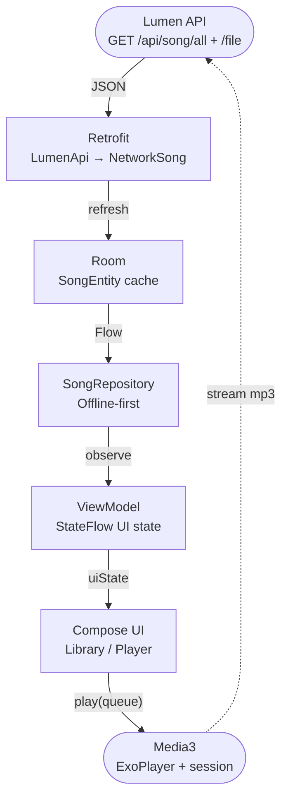

# Big picture

[Learning guide index](README.md)

Native Android app, package `com.anhtuta.lilimusic`. Uses the existing Lumen API; backend unchanged. Listener only. Only songs with a non-empty `file_name` appear; Zing-only rows are hidden.

Multi-module layout: `feature:*` screens, `core:*` plumbing, `:app` for Hilt, navigation, Media3 service. Features depend on core; never the reverse.

| Module | Role | Java / web analogy |
| --- | --- | --- |
| `:app` | Application, MainActivity, NavHost | Spring Boot main + React Router |
| `:core:model` | Song, PlayMode, PlayQueue | Domain layer (no Android) |
| `:core:network` | Retrofit + OkHttp + serialization | Feign / typed axios + Jackson |
| `:core:database` | Room song cache | JPA over SQLite |
| `:core:datastore` | Sort / play mode / speed prefs | localStorage |
| `:core:data` | Repositories | Service owning cache + API |
| `:core:playback` | Media3 ExoPlayer + session | Audio engine (no UI) |
| `:core:lyrics` | Lyric parsers (stub until Phase 4) | Pure JVM parser lib |
| `:core:ui` | Material 3 theme | Shared design system |
| `:feature:library` | List, sort, search | Catalog page |
| `:feature:player` | Now-playing + mini-player | Player page / sticky bar |
| `:feature:lyrics` / `:feature:settings` / `:feature:downloads` | Later phases | Future routes |

Song flow: API → Retrofit → Room → Repository → ViewModel → Compose → Media3. See [PR #15 Play](04-playback.md) for `FakePlayerController` and listen policy.

## Files to keep open

- [docs/PLAN.md](../PLAN.md)
- [AGENTS.md](../../AGENTS.md)
- [README.md](../../README.md)
